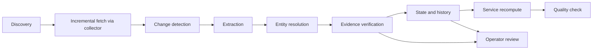

# Daemon design: collector-backed, no publication

This is a stage design, not a running scheduler. The service sits above crawler/:
reuse its approved-source policies, reviewed robots dates (maximum age 90 days),
leases, bounded fetches and privacy filter. Do not duplicate or weaken its network
gate. Its five workflow stages (candidate, source checked, deduplicated out,
verified, publish pending) remain collector-specific; the nine stages below are
service processing checkpoints, not replacements for that queue. Collector
verification is evidence input; service verification still requires an operator.
The daemon never publishes or deploys. Service recompute only rebuilds derived
tables in the service DB. The existing publication process stays separate.



## Stage contracts

Every checkpoint is `(stage, source_id, unit_id, cursor, completed_at)` in
checkpoints. Completed work is committed with its output; never checkpoint a
partially written unit. Resume from the last completed cursor, scheduling only
failed or uncompleted units. Raw capture digest, extractor version and subject
resolution version must participate in downstream unit IDs.

| Stage | Input → output | Data touched / writer | Checkpoint cursor | Idempotency key | Failure modes |
|---|---|---|---|---|---|
| source discovery | enabled registry → approved candidate IDs | collector candidate queue; discovery worker | seed cursor | source + normalized URL | source hold, pagination loop, policy expiry |
| incremental fetch | due candidate + validators → minimized snapshot digest | collector only writes collector DB; approved adapter writes external raw | last completed URL + ETag | source + response digest | block, timeout, byte cap; hold immediately as required |
| change detection | prior/new sanitized digest → changed units | service derived digest index; comparison worker | latest digest | source + old/new digest | missing previous capture; treat as first observation |
| extraction | changed snapshot → typed proposals | staging proposals; extractor only | snapshot digest | digest + extractor version | invalid JSON, ambiguous text; no invented values |
| entity resolution | proposals + aliases → subject mappings | operator-approved entities/aliases; resolver stages proposals | proposal ID | proposal + mapping version | ambiguous branch; queue identity review |
| evidence verification | proposals + source policy + locator → review decision | operator writes review_items; verifier proposes | decision ID | evidence digest + decision | missing quote/section, stale policy, source conflict |
| state/history update | reviewed observation → facts + confirmations | observe transaction; approved state writer | observation ID | deterministic fact_id | validation/interval error, conflict; preserve both sources |
| service recompute | changed fact IDs → derived service tables | internal recompute worker only | latest consumed fact/change | input fact-set digest | incomplete source scope; mark unknown |
| quality check | derived tables + evidence → quality report/holds | quality worker writes internal report, no site data | checked fact-set digest | digest + rules version | stale/unknown/conflict/privacy failures; stop downstream use |

AI extraction writes only ai_inference or unverified. It can never write
verified_fact, including when quoting an official page. A later operator action
creates a distinct verified observation with page evidence; no trust edit in place.

## Checkpoints and ownership

| Stage/source | Unit | Resume behavior |
|---|---|---|
| discovery / each seed | normalized cursor | continue after completed page |
| fetch / each source | candidate ID + validator | retry only unfinished request |
| change / each source | snapshot digest | skip already compared digest |
| extraction / each source | digest + extractor | reuse accepted output |
| resolution / each source | proposal + mapping | unresolved goes to review |
| verification / each source | evidence + decision | wait for operator, no auto approval |
| state / each source | fact_id | deterministic insert or confirmation |
| recompute / each source | fact-set digest | atomically replace derived view tables |
| quality / each source | digest + rules | recheck only changed inputs |

Workers have per-stage leases in run_locks. Use UTC-normalized timestamps in these
operational tables (facts retain KST). Acquire under BEGIN IMMEDIATE. A live owner
renews with an owner-qualified update; an unrelated owner can take over only after
expiry. Heartbeat every 20 seconds, expiry 90 seconds. Every write transaction
must recheck owner and unexpired lease; an expired worker cannot checkpoint.

```sql
BEGIN IMMEDIATE;
INSERT INTO run_locks(stage,owner,heartbeat,expires_at)
VALUES (:stage,:owner,:now,:expiry)
ON CONFLICT(stage) DO UPDATE SET owner=excluded.owner,
 heartbeat=excluded.heartbeat, expires_at=excluded.expires_at
WHERE julianday(run_locks.expires_at) <= julianday(:now);
-- Require changes() = 1; otherwise stop this worker.
COMMIT;
-- Renewal must still own an unexpired lease.
UPDATE run_locks SET heartbeat=:now,expires_at=:expiry
WHERE stage=:stage AND owner=:owner
 AND julianday(expires_at)>julianday(:now);
```

failure_queue stores failure_id, stage, source_id, unit_id, reason, attempts,
next_retry_at, state pending/dead/resolved. At most three attempts with delays
60 seconds, 5 minutes, 30 minutes (bounded jitter). After attempt three, dead;
operator approval is needed to reset. Privacy failures drop unsafe payloads,
retaining only reason codes. Security blocks are holds with no retry, regardless
of the general retry schedule. Replayed successful units are idempotent.

budgets uses scope (run ID or daily KST day), period, requests, bytes, ai_tokens,
ai_cost_units and respective max_ columns. Reserve estimated worst-case costs in
both run and day rows atomically under BEGIN IMMEDIATE before dispatch, then
reconcile actual use without refunding failed/uncertain requests. Default service
ceilings: 50 requests / 10 MiB / 20,000 AI tokens / 100 cost units per run;
200 requests / 40 MiB / 80,000 tokens / 400 cost units per KST day. AI defaults
to disabled with zero AI ceilings until an operator defines cost-unit conversion.
Collector caps and lower source-specific caps also apply. When any cap is reached,
finish committed units, save checkpoints and stop gracefully; do not advance the
unfinished cursor. budgets CHECK constraints prevent exceeding reserved ceilings.

## Source registry

Validate each entry with schema/source_registry.schema.json. A registry declaration
does not grant collector access. Robots/terms review and explicit policy approval
remain required. Example fixture: tests/data_foundation/fixtures/source_registry.json.
The authenticated flag means permission to collect login-walled material, always
false; the shared existing session below may only view owner-visible public text.
Do not log in automatically or transfer credentials into this service.

```yaml
id: instagram_announcements
kind: instagram
base_url: https://www.instagram.com/
handle: null
fields: [opening, relocation, closure, temporary_closure, hours, price, events]
permission:
  robots_reviewed_date: null
  terms_note: Collection restricted; owner decision pending; no authorization.
  allowed_paths: []
  public: true
  authenticated: false
  read_only: true
refresh_hours: 24
pace:
  concurrency: 1
  gap_min_seconds: 20
  gap_max_seconds: 60
  daily_cap: 20
  window_kst: "13:00-14:00"
  session: shared Agamajung (아가마중)
  stop_on_challenge: true
  bypass_allowed: false
  writes_allowed: false
retention_days: 30
status: on_hold
hold_reason: shared Agamajung account check pending; collection paused by operator 2026-10-27
required: true
supported_scope: [public announcement text, source_claim leads]
unsupported_scope: [private content, writes, images, login-walled content]
```

Other kinds are official_site, hotel_site, operator_profile, venue_reply and
event_list. Fields can include price, opening_hours, closure, bath_temperature,
sauna_temperature, access conditions and events. Each source declares supported
and unsupported scope, cadence, pace, retention and enabled/disabled/on_hold
status. An on_hold entry must have hold_reason; required does not override a hold.

Instagram is REQUIRED but currently on hold. These are hard constraints:
read-only through the shared Agamajung (아가마중) session; one profile/post view at
a time, randomized 20–60 second gaps, hard daily cap 20 views; only 13:00–14:00 KST.
Stop the entire Instagram stage immediately on any security check, challenge,
login prompt, rate-limit or action block. A human must clear it; no retry loop.
Never bypass blocks through account switching, proxies or impersonation. No
posting, liking, following, DMs or any write. Only owner-visible public content:
opening/relocation/closure/temporary closure announcements, hours/price notices
and event posts. These are source_claim leads needing official-page confirmation
before verified_fact. Instagram robots and terms restrict automated collection;
this is a documented risk and an open owner decision, not collection approval.
Raw text captures expire after 30 days in the external raw store. Existing example
captures at /workspace/hanset-collector/ig_reads stay there and are not copied.

## External storage

Raw: `/workspace/hanset-data/raw/<source_id>/<sha256>` (minimized permitted text
only); DB: `/workspace/hanset-data/db/hanset_facts.sqlite3`. HANSET_DATA_DIR
changes the common root. Resolve symlinks and refuse repository-internal DB/raw
paths using data_foundation.db.external_path. The collector keeps its own
`$XDG_STATE_HOME/hanset-collector/collector.sqlite3` or
`~/.local/state/hanset-collector/collector.sqlite3`, unchanged.

## Unsupported scope (explicit)

No real-time bath sensors: temperatures are venue-published observations only.
No booking/availability queries, login-walled sources, photos/images, personal
data, reviews/ratings scraping or third-party aggregators as verified facts.
Naver is not a source.
No automatic publishing. Safety guidance on existing sauna content remains in
place; no health-effect claims are produced by this service.
